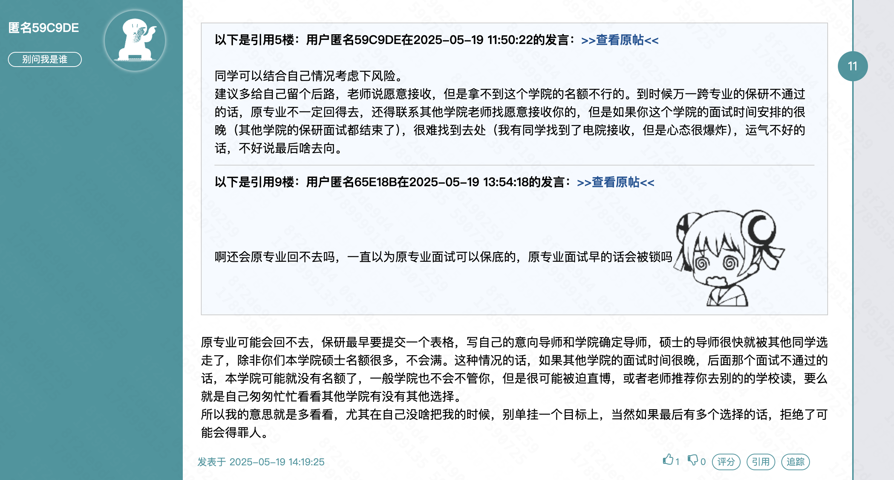
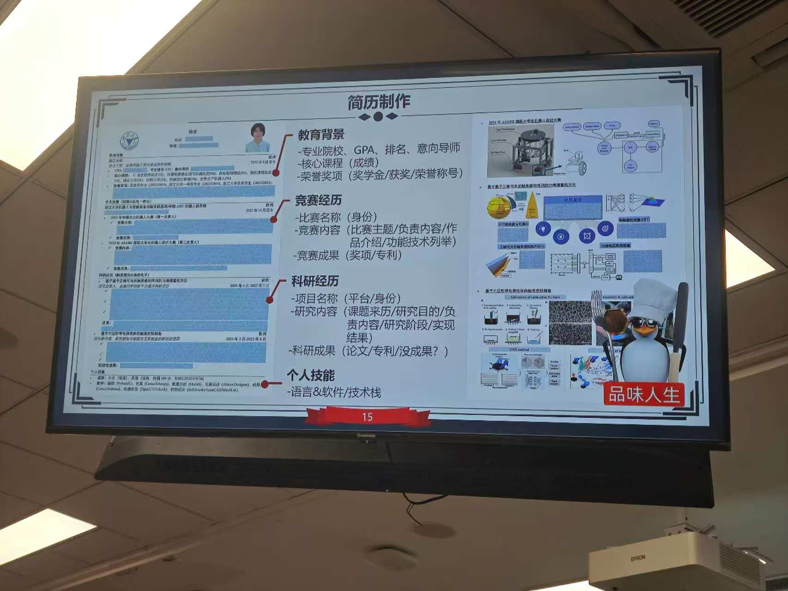
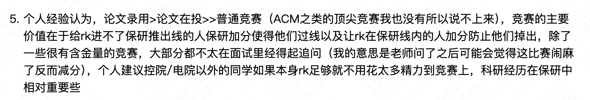

【科研学术】谈谈保研——命运齿轮的再次转动（tag：跨保/推免/夏令营/套磁/选导师） https://www.cc98.org/topic/6117401 复制本链接到浏览器或者打开【CC 98】微信小程序查看~

【科研学术】跨保机械的难度 https://www.cc98.org/topic/6052531 复制本链接到浏览器或者打开【CC 98】微信小程序查看~

必要时联系一下学长？

查找一下跨保流程，98 上没找到资料，首先研究清楚本院有没有保底，会不会冲突

找找看还有没有什么比赛可以参加

寒假期间的美赛

后面的策略就是，把上课的精力分配到竞赛和科研上，积极关注信息

看一下学姐的科研经历是完成一段仔下一段还是怎么样

学姐之前是 24.4-25.5 启真问学
25.2-25.6 另一段科研

现在的话我觉得就是启真问学的项目先搞好，考虑到 7 推的影响，可能寒假之前就要联系其他老师开始一段新的科研项目了。

研究一下排名

退路，考研，研究一下硕士名额

要争取发文章
【科研学术】复盘从机械跨保到软件学院的心路历程（Tag:跨保/浙软/软院/控院/具身/转码/传统工科/机械） https://www.cc98.org/topic/6635891 复制本链接到浏览器或者打开【CC 98】微信小程序查看~

跨保真是孤注一掷吗

留在本专业读研究生绝对是痛苦的，痛苦的来源就是我一直对本专业前景的不信任，本科阶段我已经多次进行否定，若是还继续读研一定是身处更久的自我否定中

## 优先级

T 0：浙大机械，机器人相关组
T 0.5:浙大机械，转码相关组
T 1:上交机动所，机器人、具身相关组

## 要弄懂的问题

浙大本校是不是不需要参加夏令营
能不能同时报本校的多个专业

