期末补天笔记...

计划：

- [ ] 看完 ppt
- [ ] 重做习题、实验题
- [ ] 做历年题
- [ ] 模拟题
- [ ] 再背一遍

# 单片机结构

外部引脚

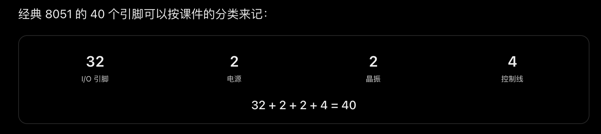

内部数据存储器的组成？

## 堆栈

在用户 RAM 区（30H-7FH）设置堆栈，所以常见的是在

堆栈的初始地址是 07H

堆栈的作用：
 - 保护程序断点

## 特殊功能寄存器

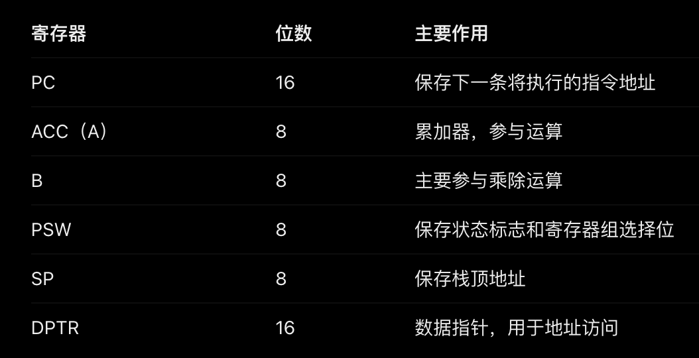

记一下 P3 口的第二功能
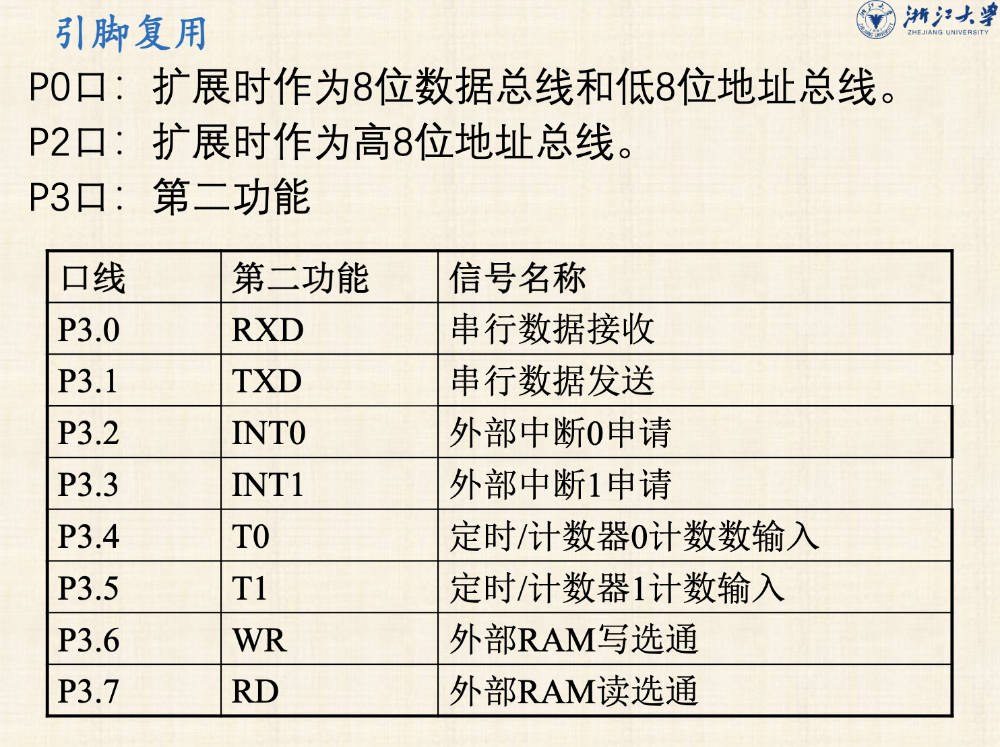

# 单片机指令系统

### 1. 数据移动与交换

| 指令     | 英文含义            | 功能              | 示例               |
| ------ | --------------- | --------------- | ---------------- |
| `MOV`  | Move            | 传送数据，源不变        | `MOV A,#30H`     |
| `MOVX` | Move External   | 访问外部 RAM        | `MOVX A,@DPTR`   |
| `MOVC` | Move Code       | 从程序 ROM 读取数据    | `MOVC A,@A+DPTR` |
| `XCH`  | Exchange        | 交换两个字节          | `XCH A,R0`       |
| `XCHD` | Exchange Digits | 交换低 4 位，高 4 位不变 | `XCHD A,@R0`     |
| `SWAP` | Swap            | 交换 A 的高低 4 位    | `SWAP A`         |
| `PUSH` | Push            | 压栈，SP 先加 1      | `PUSH 30H`       |
| `POP`  | Pop             | 出栈，SP 后减 1      | `POP 30H`        |

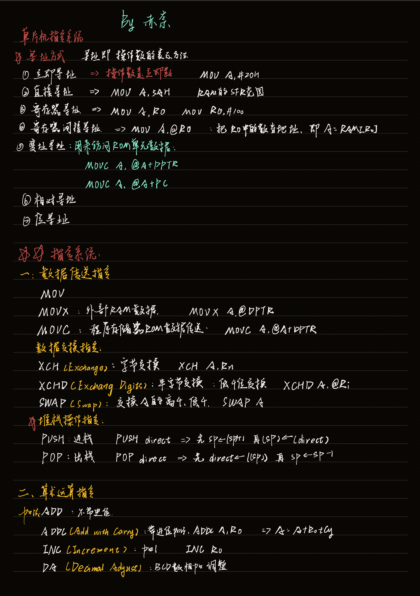

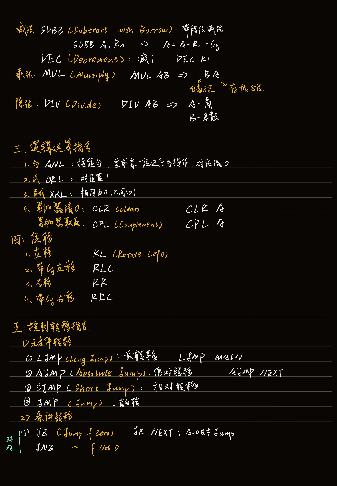

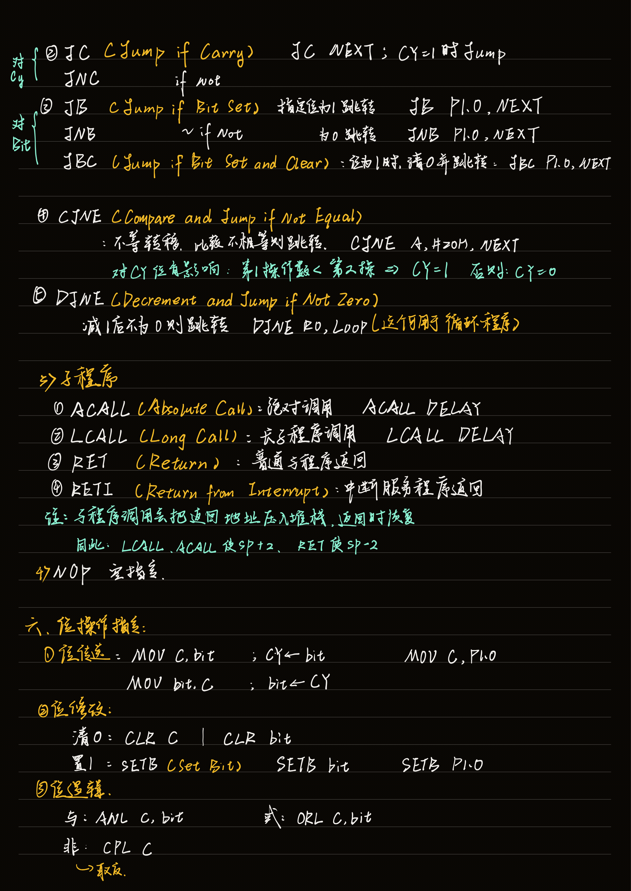

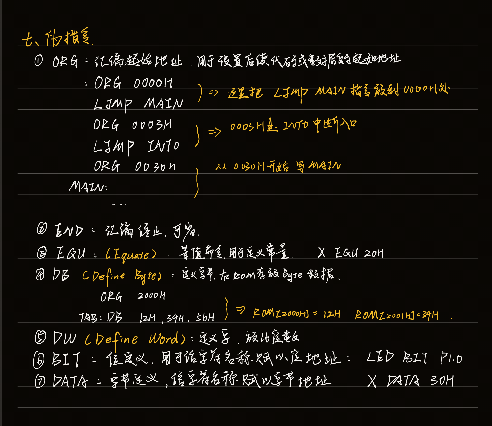

**概念记忆**：

什么是汇编？
>  汇编：将汇编语言翻译成机器语言

什么是伪指令？

>  告诉汇编程序汇编方法的命令，不生成机器代码

# 汇编语言程序设计

- 顺序
- 分支
- 循环
- 子程序

综合设计：
- 输出方波信号

# 单片机内部资源

- 中断
- 定时
- 串行通信

## 中断 

>  这里记忆的内容比较多，而且有点难记，让 ai 整理了一下记忆方法
>  发现和上面的指令系统一样，了解英文名的命名规则之后就好记一些

**感觉按照这个地址递增记忆比较好，因为后续 IE 、IP 地址位对应中断源也是这个顺序，发现中断优先级也是这个顺序**

同级情况下中断优先级：

$$
IT0 \gt T0 \gt INT1 \gt T0 \gt 串口
$$

|中断源|允许位 IE|优先级位 IP|请求标志|入口地址|
|---|---|---|---|---|
|外部中断 0|EX0|PX0|IE0|0003H|
|定时器 0|ET0|PT0|TF0|000BH|
|外部中断 1|EX1|PX1|IE1|0013H|
|定时器 1|ET1|PT1|TF1|001BH|
|串口中断|ES|PS|TI / RI|0023H|

还有：外部中断 0（INT0）对应外部引脚 P3.2 ；外部中断 1（INT1）对应外部引脚 P3.3

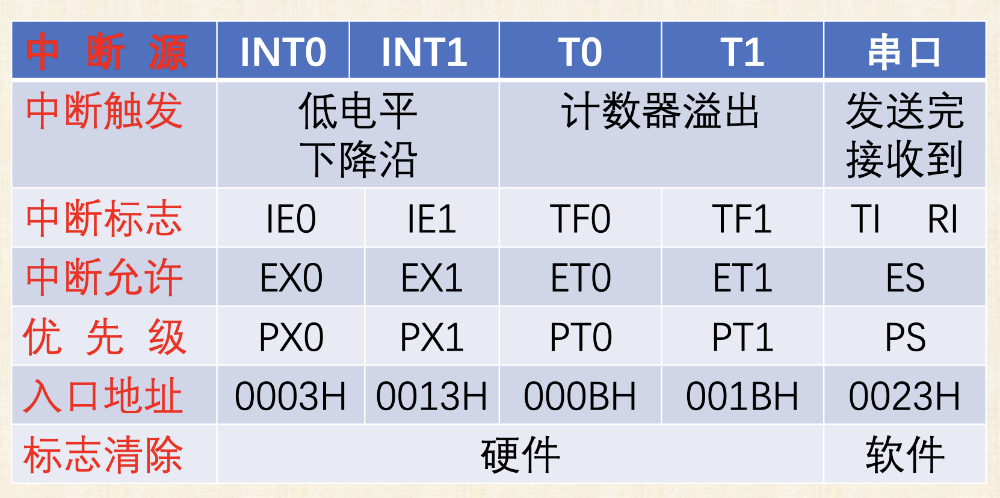

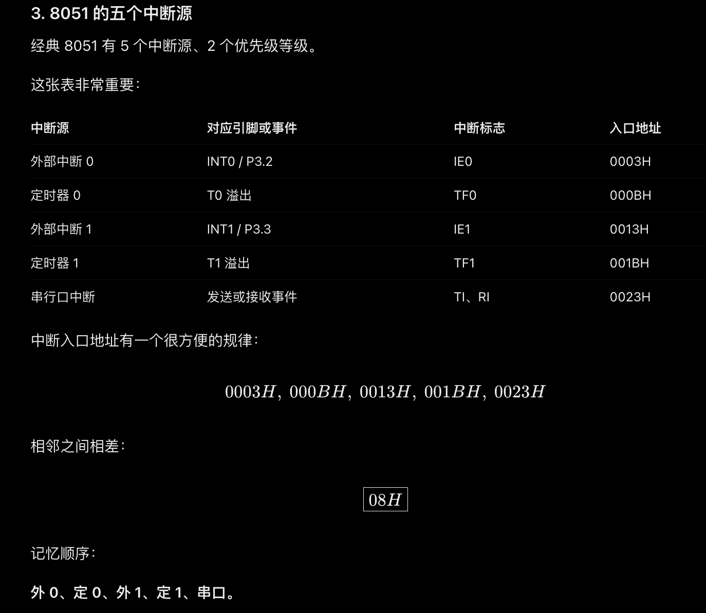

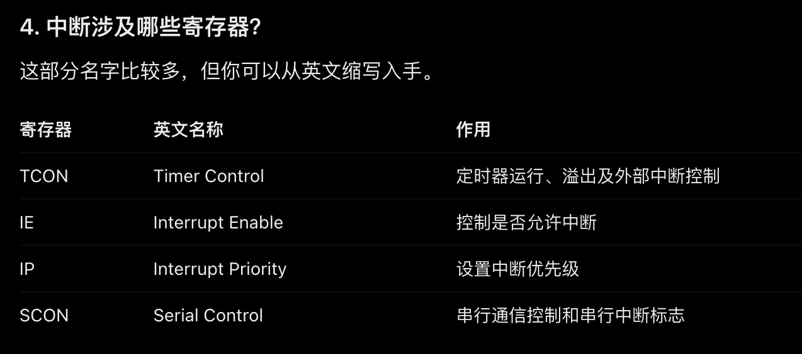

- IE 相当于开关，决定是否允许中断。
- IP 相当于优先级排队表。
- TCON 包含定时器与外部中断的运行、触发及状态信息。
- SCON 包含串口的工作控制及收发状态信息。

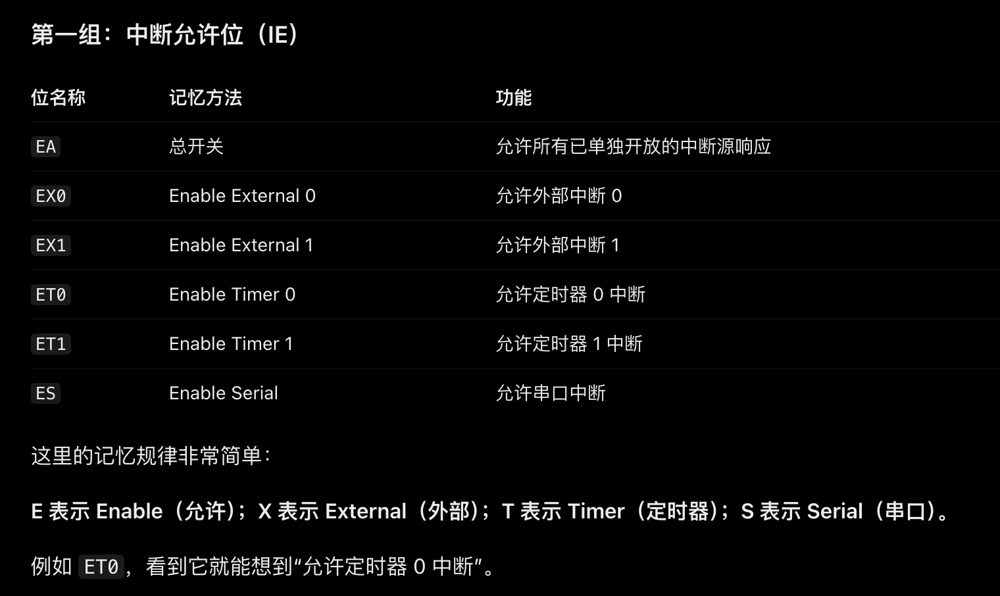

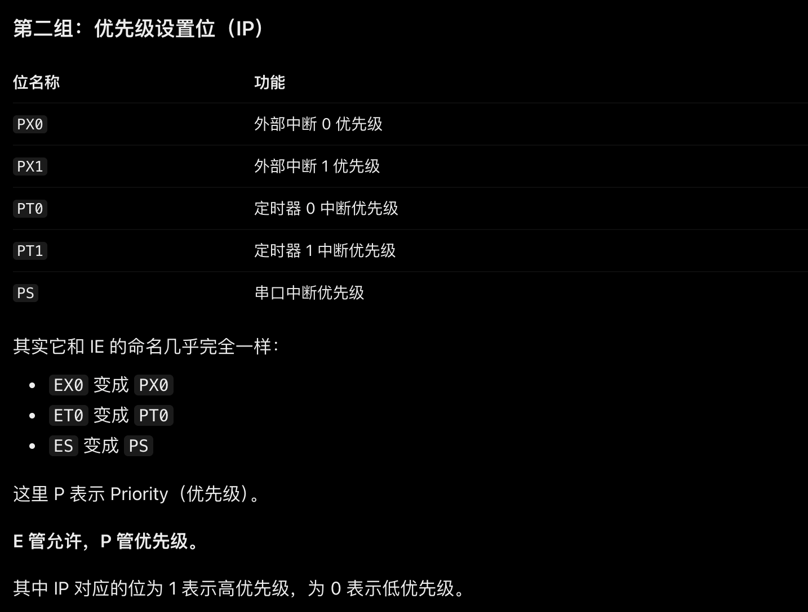

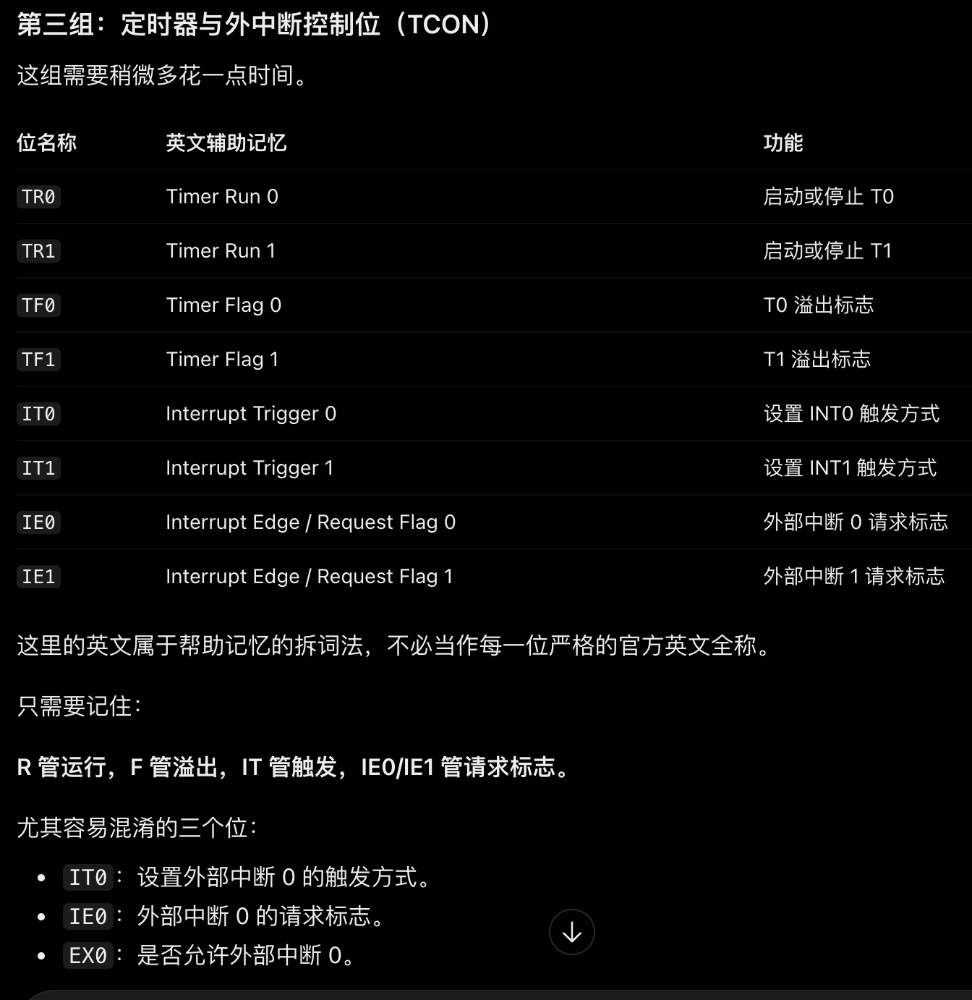

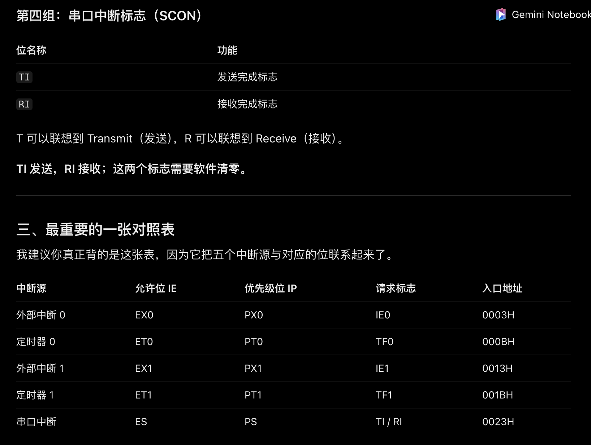

## 中断程序设计

## 定时计数器

## 串行口

