# 机械制造基础

记录上课笔记

!!! info "成绩构成"
	期末闭卷考试

## 1. 金属材料的力学性能

## 3. 铁碳合金

### 金属的晶体结构

晶格

过冷度

金属结晶过程
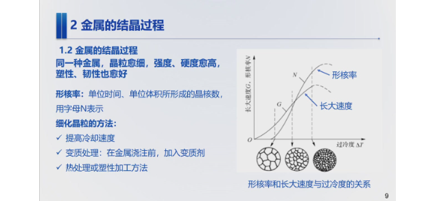

### 铁碳合金基本组织与性能

合金：合金是一种金属元素与其他金属元素或非金属元素通过熔炼或其他方法结合而成的具有金属特性的的材料。  
组元：组成合金最简单的、最基本的、能够独立存在的元物质，简称元。（决定性能潜力）  
**相**：合金中成分、结构及性能相同的组成部分。

**铁碳合金基本组织与性能**

1. 固溶体

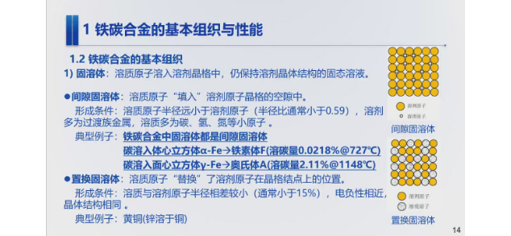

固溶强化
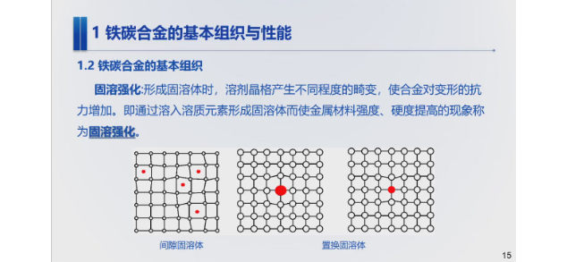

2. 金属化合物：渗碳体 $Fe_3C$
3. 机械混合物：珠光体（铁素体+渗碳体）、莱氏体

基本相和机械混合物：
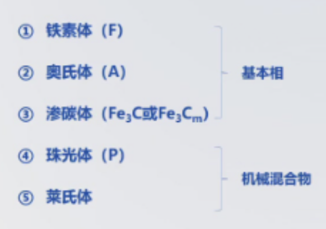

基本组织与性能

1. **铁素体**：

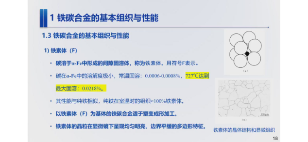

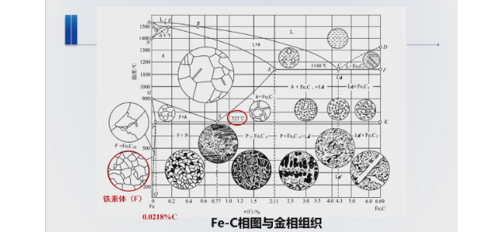

2. **奥氏体**
	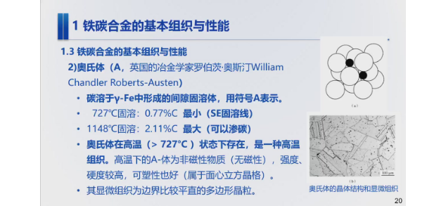

3. 渗碳体：硬度高、脆性大
	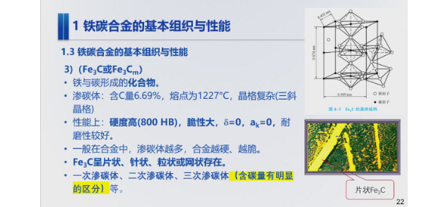
4. 珠光体（P）
	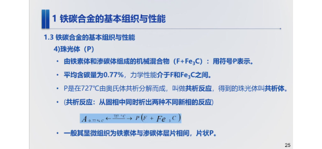
5. 莱氏体
	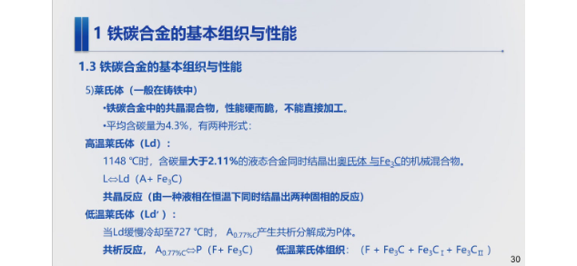
	共晶反应

$$
\boxed{\text{珠光体}=\text{铁素体}+\text{渗碳体}}
$$

### 铁碳合金相图

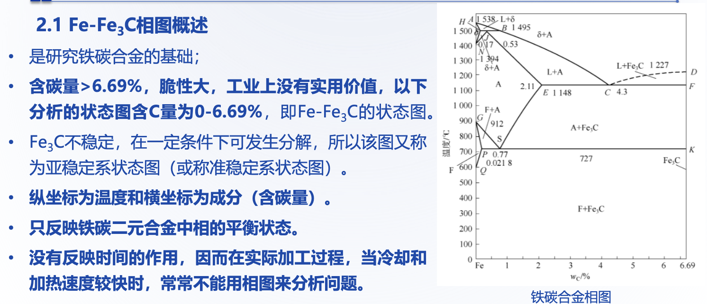

重要点
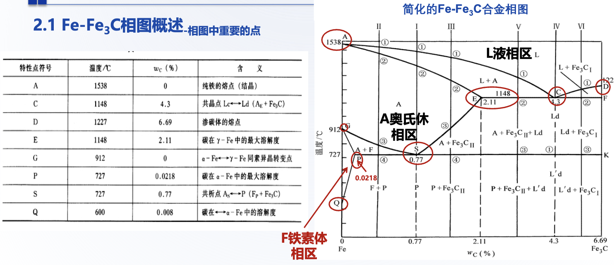

C：共晶反应生成莱氏体

重要线：

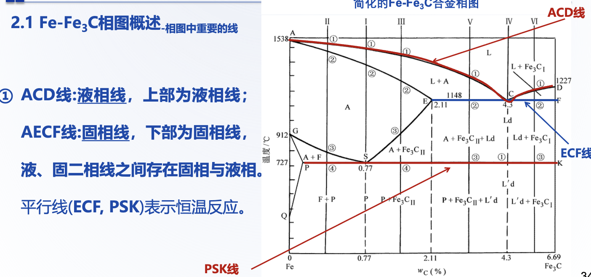

ECF ：共晶反应线

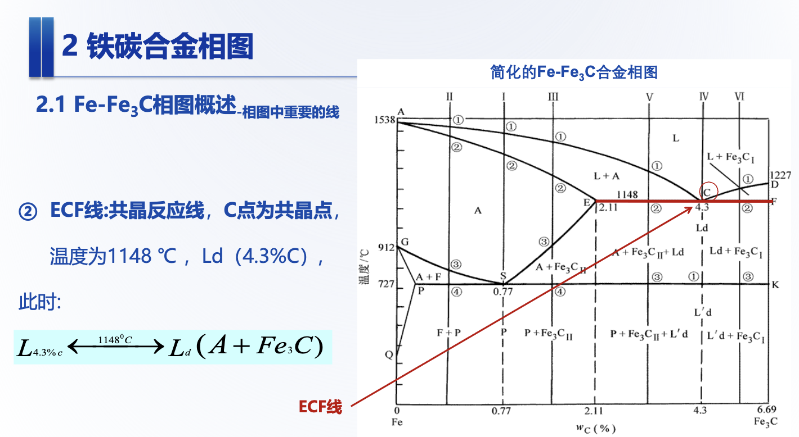

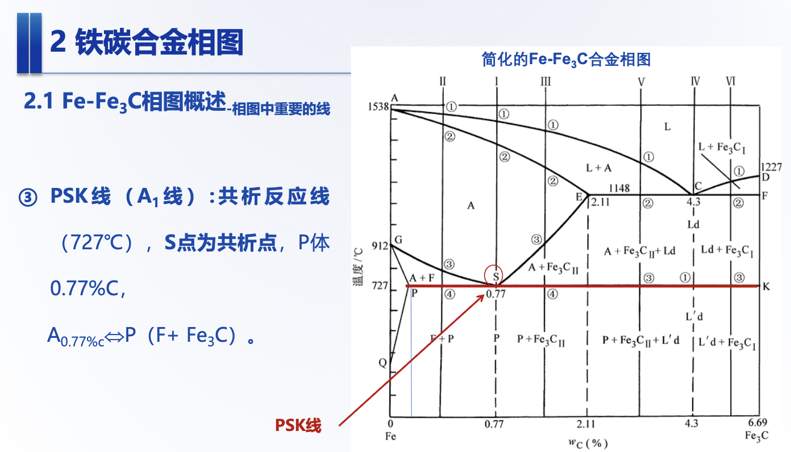

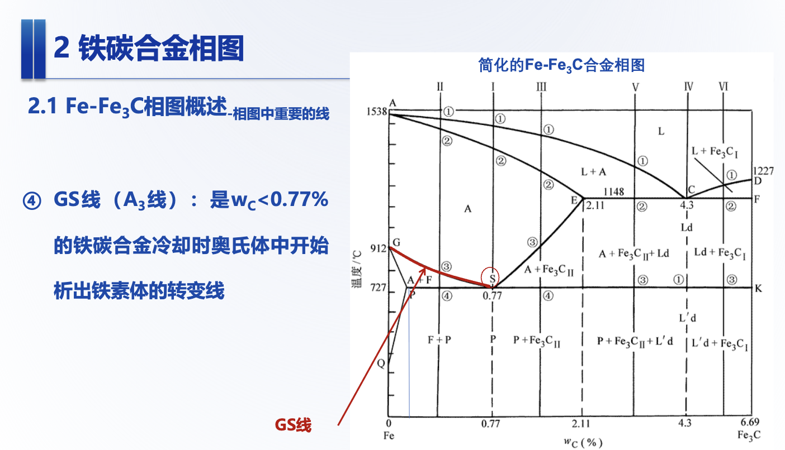

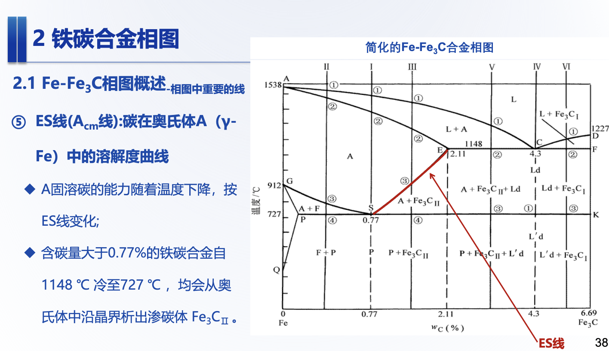

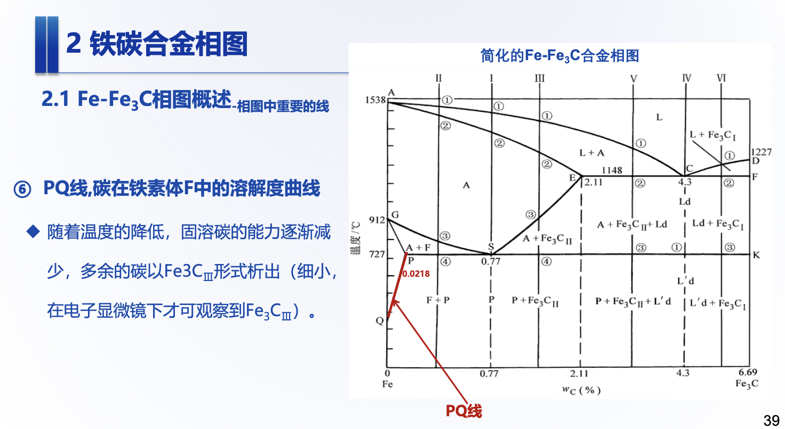

A+F 奥氏体+铁素体

铁碳合金分类

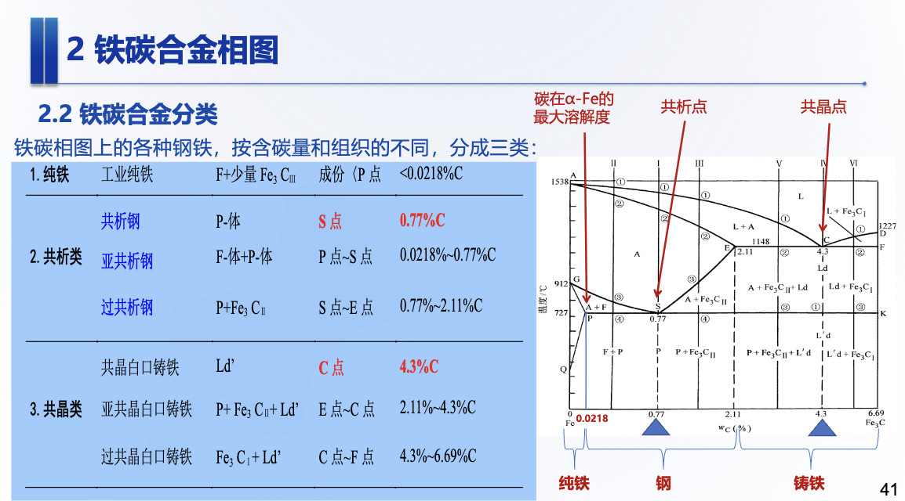

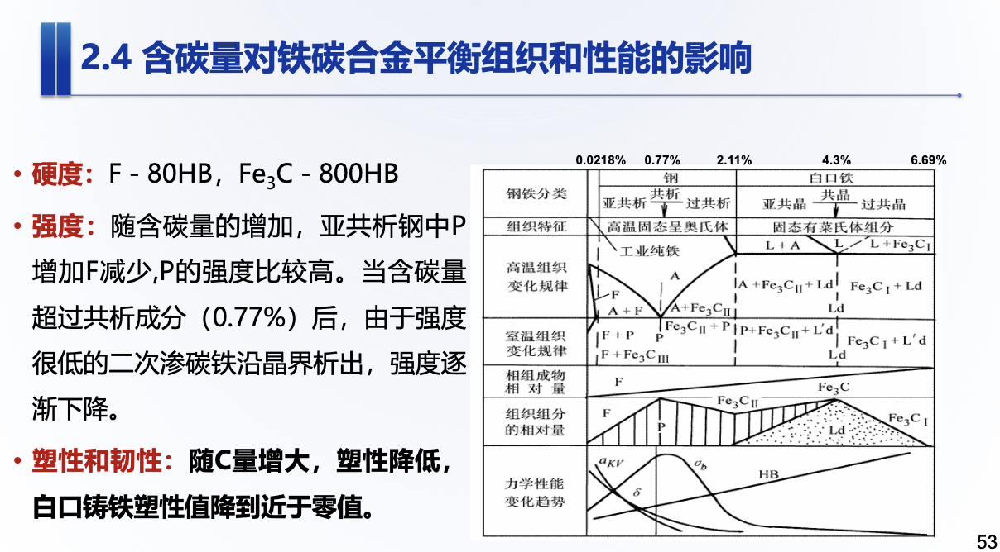

## 4.钢的热处理

钢的热处理：通过**加热、保温、冷却**，改变其组织，获得所需性能的一种加工工艺。

热处理的原理：  
1. 热处理是基于**同素异构转变、共析转变、固溶和脱溶**等**固态**下的**组织转变**来改变材料性能的。  
2. 热处理工艺的任务是不改变原有的形状尺寸**仅改变金属材料的性能**。  

### 热处理的分类

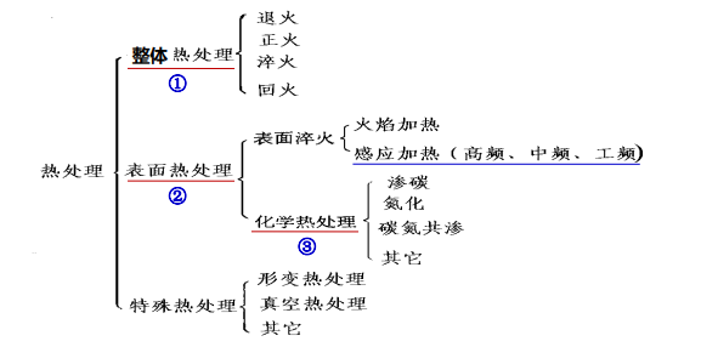

### 热处理过程中的组织转变

[图片]

奥氏体晶核的形成

奥氏体化：加热工件，使温度达到共析温度以上，使常温下的铁素体和渗碳体再转变回奥氏体。（奥氏体塑性好，是绝大多数钢种在高温下进行压力加工时所要求的组织）

共析钢为例的奥氏体化
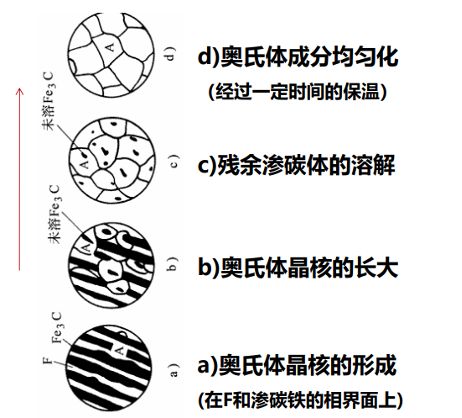

**奥氏体的长大**

奥氏体晶粒的大小直接影响到冷却后转变产物的晶粒大小和力学性能。奥氏体晶粒大小是评定热处理加热质量的主要指标之一。

奥氏体晶粒的长大因素：
1. 加热温度越高，长大速度越快
2. 保温时间延长，晶粒不断长大
3. 加热速度越快，过热度越大，形核率越高

**钢在冷却时的组织转变**

以共析钢为例：

1. 奥氏体的等温转变

贝氏体

马氏体

马氏体的组织形态：
板条状：又称位错马氏体或低碳马氏体。（具有较高硬度和强度与较好塑性和韧性）
针片状：又称孪晶马氏体或高碳马氏体。（具有更高的硬度，但脆性较大、塑性和韧性较差）

**重点：钢的奥氏体 TTT (CCT) 曲线**

