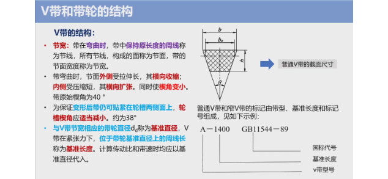
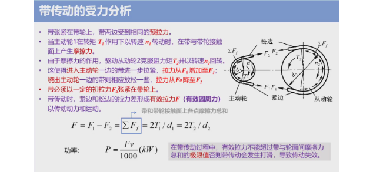
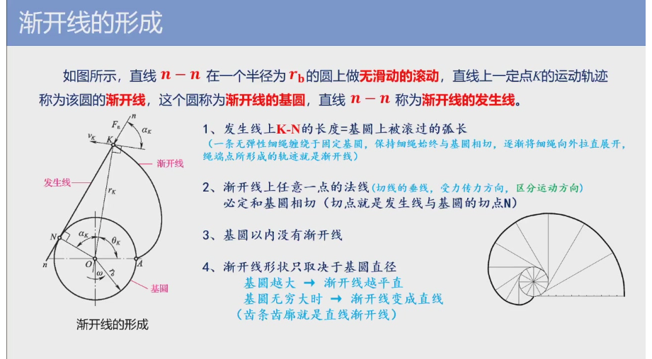
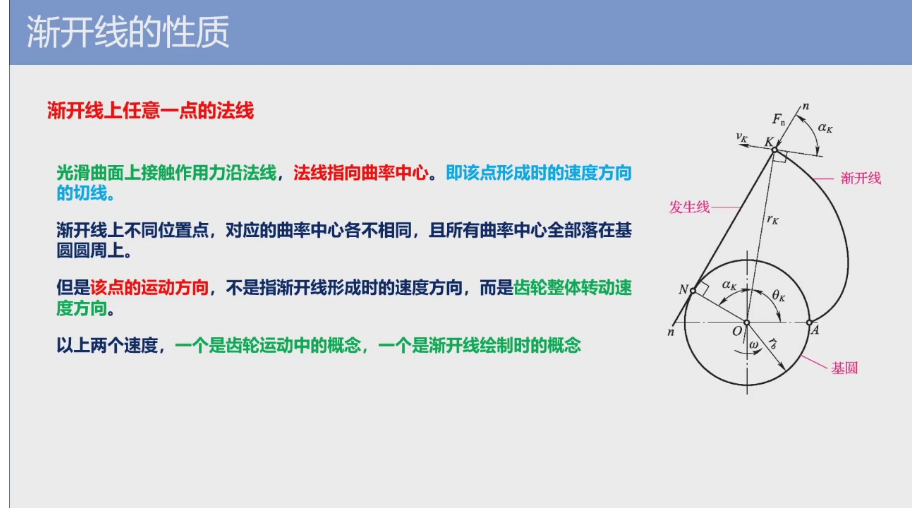
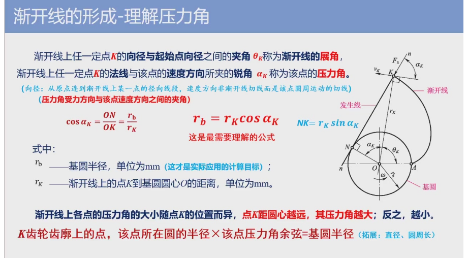
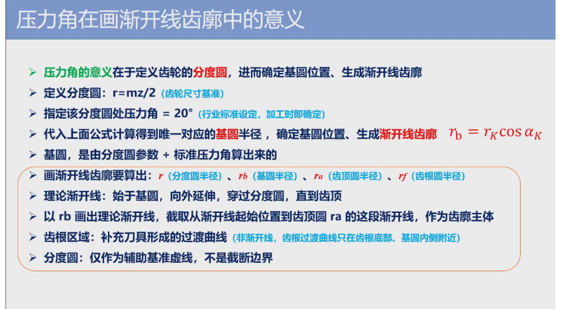
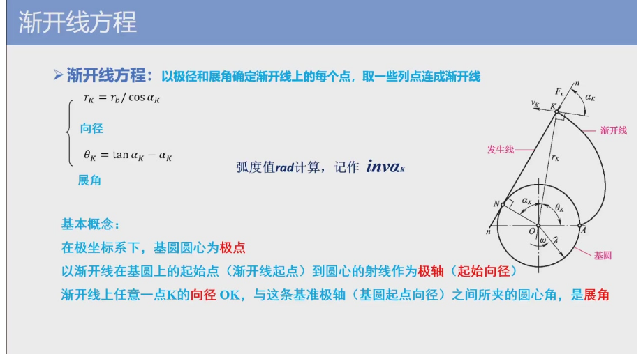
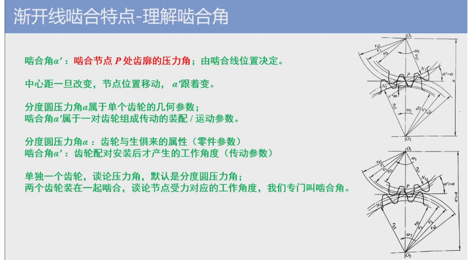

自学出 10 道题？

## 带传动

- 缓冲吸振
- 过载保护
- 传动比不准确

- 开口传动
- 交叉传动
- 半交叉传动（两个轮垂直）

### V 带和带轮结构

### 传送带受力分析

## 链传动

- 与带传动相比，能保持准确的**平均传动比**，**径向压轴力小**，适合低速情况下工作

## 齿轮传动

### 渐开线

渐开线

**区分两个速度**：
- 渐开线形成时速度方向
- 渐开线形成后的齿廓转动时速度方向：速度垂直向径 OK（点到圆心）

压力角：压力方向和速度方向形成的夹角，正压力 NK 方向（法线），速度方向指的是齿轮运动时的速度方向（速度垂直向径）
> 怎么理解法线，看形成渐开线的过程，过程中的速度为切线，速度垂直方向为法线方向

压力角可用于定义分度圆

**啮合角**

>  definition：啮合节点 P 处齿廓的压力角，由啮合线位置决定

**渐开线啮合特点**

- 四线合一
- 中心距可分性
- 啮合角不变

**齿轮各部分的名称和符号**

- 齿顶圆
- 齿根圆
- 齿厚
- 齿槽宽
- 齿距
- 齿宽（非国标）
- 齿数 z
- 分度圆 d
- 模数 m：$m=\frac{p}{\pi}=\frac{d}{z}$

**基本参数和尺寸计算**

计算判断连续性传动
