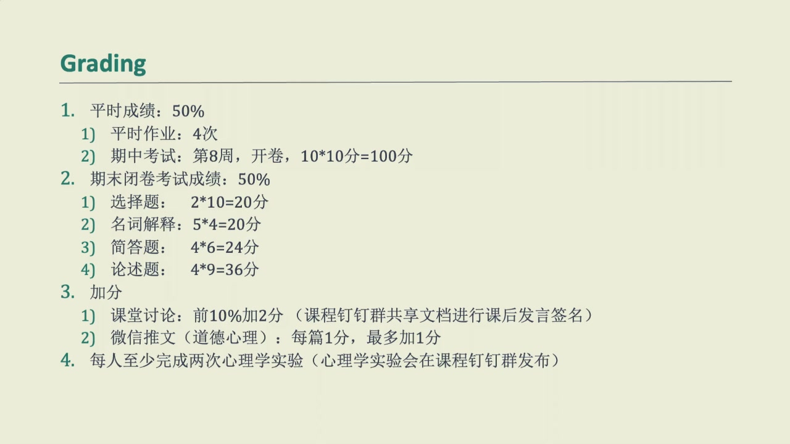
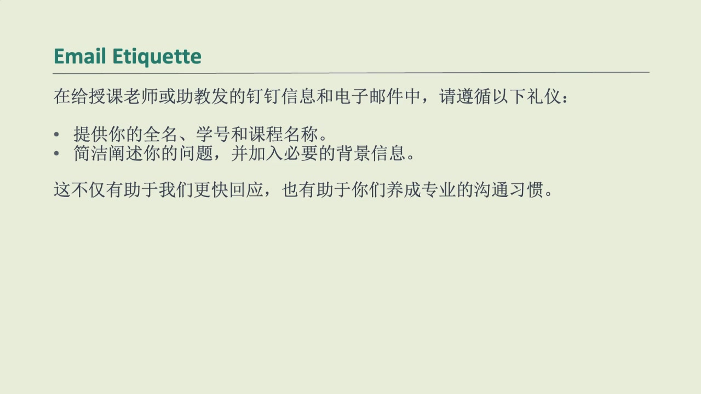
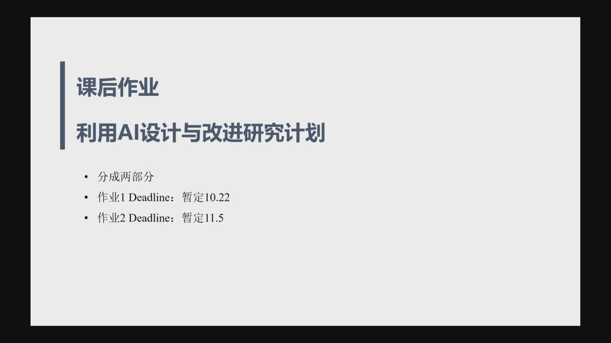
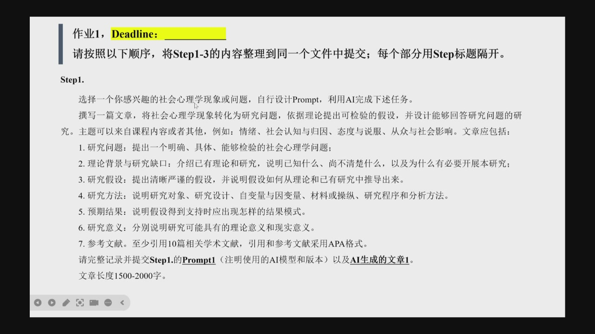
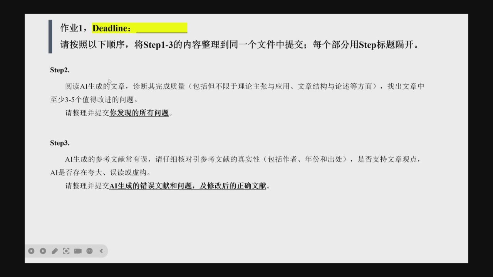
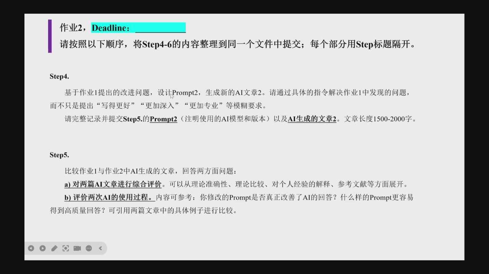

# 社会心理学
第一节课
!!! info "成绩构成"
	期中考试占比总评 30%
	平时作业：ai 完成作业，模型、提示词

作业 1ddl：10.29
作业 2ddl：11.15

## 社会心理学及其研究方法

!!! tip "要点"
	- 什么是社会心理学  
	- 社会心理学研究什么  
	- 社会心理学的基本概念  
	- 我们用什么方式测试理论  
	- 重复性危机  

## 情绪

### 情绪的理论

>  definition ：关于情绪产生机制的可验证陈述

**达尔文情绪进化理论**（Evolutionary theories）
**情绪认知评价理论**
**情绪构建理论**

## 如何学习情绪

情绪怎么测量

- self- report
- biological measures
- nonverbal expressions
	- facial expressions
	- pupil dilation
	- gesture
	- touch
	- voice

## Attitudes and Behavior 态度和行为

组成：

- 情感
- 认知
- 行为

### 态度的测量方法

1. implicit measures

